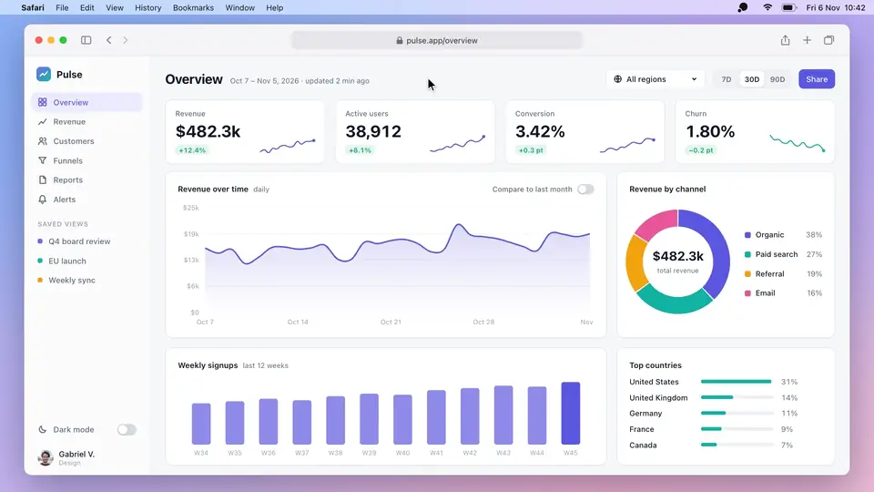
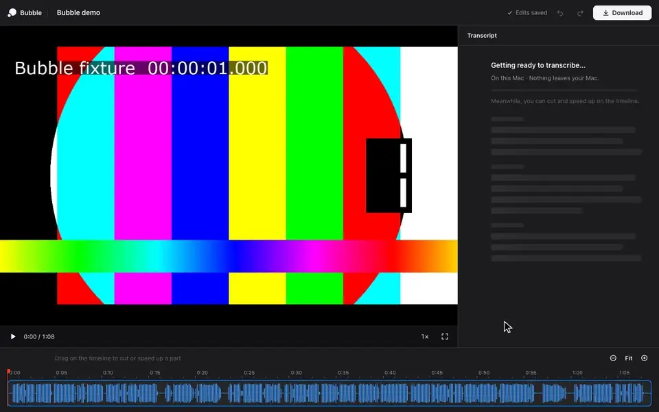

# Bubble

**An open-source alternative to Loom for macOS.** Record your screen with your face in a bubble, then trim it by
editing the transcript. Free, no account, and everything stays on your Mac.

[](media/demo.mp4)

<sub>[Watch it as mp4](media/demo.mp4) (56 s, captions, no sound).</sub>

[**⬇️ Download Bubble for macOS**](https://github.com/gvergnaud/bubble/releases/latest) · macOS 15+, Apple silicon

## Get started in 1 minute

1. **Download** `Bubble-<version>.zip` from [Releases](https://github.com/gvergnaud/bubble/releases/latest),
   unzip it and drag **Bubble.app** to Applications.
2. **Double-click Bubble.app.** It's signed and notarized by Apple: macOS asks once if you want to
   open an app downloaded from the internet, click **Open**.
3. **Allow the permissions** in Bubble's Welcome window: **Screen Recording** (then relaunch Bubble),
   **Camera** and **Microphone**.
4. **Press ⌥⇧L** to start. You get a 3-2-1, then you're recording. **Press ⌥⇧L again** to stop.
5. **Your video is ready**: an `.mp4` in `~/Movies/Bubble`, already copied to your clipboard. Paste it
   in Slack, a mail or a doc.
6. **Want to trim it?** Click **Edit** in the Recordings window (or **Edit Last Recording** in the menu
   bar). The editor opens in your browser.
7. **Any other video too.** **File › Open Video…** (⌘O), drop it on Bubble's Dock icon, use Finder's
   **Open With › Bubble**, or click **Open Video…** (or drop the file) in the editor.

## Features

- 🎥 **Screen + camera bubble.** Your whole display, your mic, your face in a round bubble. Drag it
  to any corner, pick S, M or L, hide it mid-take.
- 🔊 **Computer sound too**, mixed with your voice, if you want it.
- ⏸️ **Pause, resume, discard.** Take a break, or throw a take away with one shortcut.
- ♾️ **No limits.** No time limit, no watermark, no account, no upload.
- 📁 **Files on your Mac.** Plain `.mp4` files in a folder you choose. Bubble never changes them.
- ✍️ **Edit by the words.** The transcript sits next to the video. Select words and press Delete to
  cut them from the video. Undo anything.
- ⏩ **Speed up the slow parts.** Select a stretch and play it at 1.25×, 1.5× or 2× instead of cutting it.
- 🎚️ **Smooth cuts.** The sound fades across each cut, so the edit doesn't click.
- 🧠 **Transcription on your Mac or with Voxtral.** Apple's on-device speech (macOS 26), or
  Mistral's Voxtral with your own API key, for better words and speaker names.
- ⬇️ **Download the edit** as a new `.mp4`. The original stays as it was.
- 📂 **Edit any video, not only your recordings.** Any MP4, MOV or M4V from any folder or drive. It's
  edited where it is: never copied, never changed. Moved or renamed later, Bubble finds it again;
  the editor's home lists your recent videos.

[](media/editor.mp4)

<sub>The editor, on the Pulse walkthrough above: it transcribes on its own, a stumble cut, a slow sentence at 1.5×, then Download. [Watch it as mp4](media/editor.mp4).</sub>

## Shortcuts

| Shortcut | What it does |
|---|---|
| ⌥⇧L | Start or stop recording (works from any app) |
| ⌥⇧P | Pause or resume |
| ⌥⇧C | Discard the take (press twice) |
| ⌘0 | Open the Recordings window |
| ⌘E | Edit the selected recording |
| ⌘O | Open any video in the editor |
| ⌘, | Settings |

In the editor: **Delete** cuts the selection, **⌘Z** / **⇧⌘Z** undo and redo.

## 🔒 Privacy

Nothing leaves your Mac, with one exception you turn on yourself: if you paste a Mistral API key and
transcribe with Voxtral, the recording's audio goes to Mistral to be transcribed. Your key stays in
the macOS Keychain. No analytics, no telemetry, no account. The editor runs on a local server
(`127.0.0.1` only) behind a per-install token.

## FAQ

**macOS says Bubble "can't be opened" or "can't be verified".**
Bubble 0.1.2 and later are notarized by Apple and open with a double-click. Older downloads (0.1.0,
0.1.1) are signed but not notarized: get the [latest release](https://github.com/gvergnaud/bubble/releases/latest),
or open it once and click **Open Anyway** in **System Settings › Privacy & Security**.

**Where are my recordings and my edits?**
Recordings are in `~/Movies/Bubble` (change it in Settings). Edits are saved as you go, next to the
app's data in `~/Library/Application Support/Bubble`, never in the video file itself.

**Does it work on Intel Macs?**
The download is for Apple silicon. On an Intel Mac you can build it from source (below).

## Build from source

You need the Xcode Command Line Tools (Swift 6). Xcode itself is not needed.

```sh
git clone https://github.com/gvergnaud/bubble.git
cd bubble
scripts/build-app.sh release      # -> build/Bubble.app
scripts/check.sh                  # the tests, on synthetic media (no screen, camera or mic)
```

`build-app.sh` signs with your Developer ID or Apple Development identity if you have one, else
ad-hoc (then macOS forgets the Screen Recording permission at each rebuild).

The code: `Sources/BubbleCore` (capture), `Sources/BubbleUI` (the app), `Sources/BubbleEditor` (the
editor's local server, export and transcription), `web/editor` (the editor page: plain HTML, CSS and
JS, no build step). Design and architecture notes are in `docs/`.

## License and credits

[MIT](LICENSE). Made by [Gabriel Vergnaud](https://github.com/gvergnaud), with a team of AI agents in
[bise](https://bise.dev). Inspired by Loom. Transcription by Apple's Speech framework and Mistral's
[Voxtral](https://mistral.ai).

<sub>Loom is a trademark of Atlassian. Bubble is an independent project, not affiliated with or
endorsed by Atlassian or Loom.</sub>
